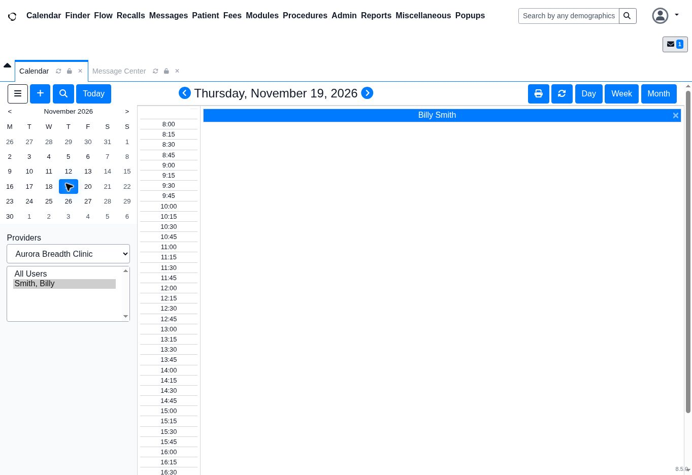
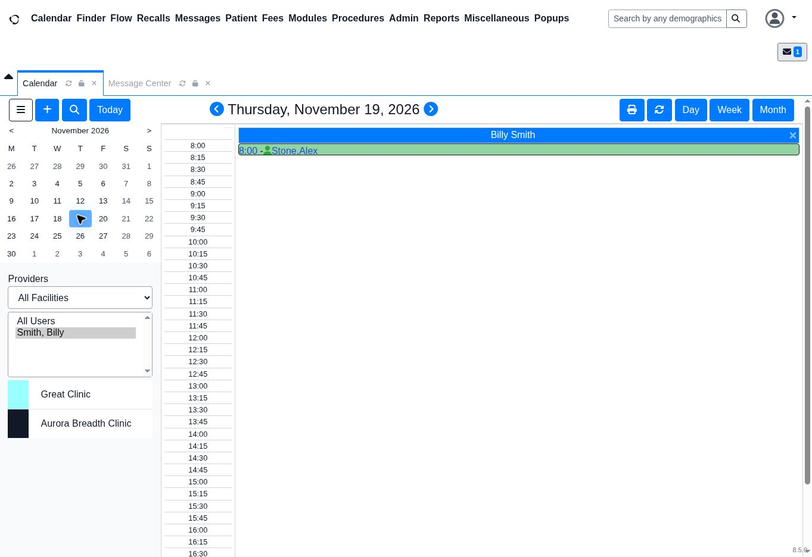

# Missing Appointment — Calendar Filter Investigation

**Evidence status:** Screenshots show the appointment visible with All Facilities and hidden with Aurora Breadth Clinic.No software defect established.

| Test context | Details |
|---|---|
| Platform | OpenEMR 8.5.0 public demo |
| Capture date | November 12, 2026 |
| Calendar date | November 19, 2026 |
| Sample appointment | 08:00, Stone, Alex; provider Billy Smith |
| Method | browser investigation using existing public-demo data |
| Changes made | Calendar date and facility view only; no appointment created, edited, or deleted |

## Support scenario

A front-desk user cannot see an appointment in the current calendar view. This is a simulated support scenario, separate from the fictional T001 ticket and its SLA timestamps.

**Potential impact:** Staff may assume the appointment is missing and create a duplicate.

## Reproduction and verification

Keep the calendar date and provider unchanged throughout the facility-filter test.

### 1. Confirm the appointment exists

Select **All Facilities**. The sample appointment appears at **08:00** under **Billy Smith**.

**Walkthrough narration — draft:**

> Hi, I’m Priyanka. This is a simulated calendar troubleshooting walkthrough using the OpenEMR demo.
>
> The reported problem is that an appointment isn’t appearing in the calendar. Before creating another booking, I would confirm the appointment date, provider, and selected facility.
>
> Here, the sample appointment is visible at eight o’clock on November nineteenth, under Billy Smith, with All Facilities selected.

### 2. Reproduce the visibility issue

Select **Aurora Breadth Clinic** in the facility dropdown. The appointment disappears from the current view.

**Walkthrough narration — draft:**

> When Aurora Breadth Clinic is selected, the appointment disappears. The date and provider remain unchanged, so the facility filter is the relevant difference.

### 3. Restore the view and verify

**Verification step to repeat:** Select **All Facilities** again and confirm the same appointment appears at **08:00** before creating any replacement booking.

**Walkthrough narration — draft, matched to the available evidence:**

> To restore the view, I would select All Facilities again and check that the same appointment appears.
>
> The visible and hidden screenshots are consistent with the appointment being hidden by the facility filter. I would ask the user to repeat that check and confirm they can locate the original booking before creating another appointment. This result does not establish a software defect.
>
> If it remained missing with the correct filters, I would check the booking record and collect the findings for further investigation.

## Expected versus actual behavior

| View | Expected | Observed |
|---|---|---|
| All Facilities | Existing appointment visible | Visible at 08:00 |
| Aurora Breadth Clinic | Appointments from other facilities excluded | Sample appointment hidden |
| All Facilities restored | Existing appointment visible again | Reported; fresh after-action capture unavailable |

**Finding:** The observed behavior is consistent with facility filtering. This test reproduced the symptom of a missing appointment; it did not establish a software bug.

## Suggested customer reply

> Thanks for flagging this. Please confirm the appointment date and provider, then check the facility dropdown on the left. Select All Facilities to see whether the appointment appears. If it appears, confirm it is the original appointment before making further changes. Please avoid creating a duplicate until the original booking has been checked.

## Escalation decision

No engineering escalation is indicated by this test. If the appointment remains missing with the correct date, provider, and facility selected, continue investigation:

- Verify whether the booking record and confirmation exist.
- Establish whether one or multiple appointments or users are affected.
- Record expected versus actual behavior and exact reproduction steps.
- Collect sanitized errors and screenshots through approved channels.
- Escalate with clinic impact, findings, an accountable owner, and the next update.

## Evidence and limitations

- Screenshots were captured through an demo browser session, not a live customer session.
- no real clinic records were supplied.
- A narrated walkthrough has not yet been recorded.

[Back to portfolio](../README.md) · [Booking troubleshooting SOP](platform-support-sop.md#8-booking--calendar-troubleshooting)
